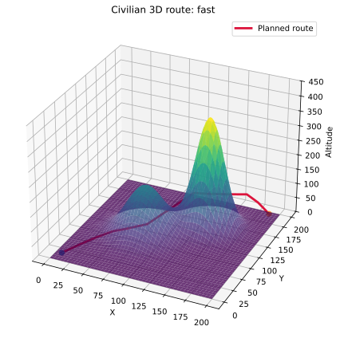
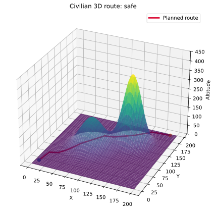
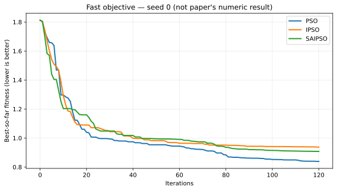
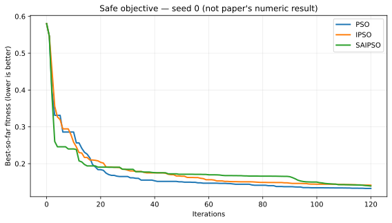

# SAIPSO-UAV-Repro

**[中文](#中文) | [English](#english)**

Paper-informed SA-IPSO optimizer reconstruction with reproducible **civilian 3-D terrain / restricted-airspace route planning**. **This is an independent benchmark, not the authors' original MATLAB code or an exact numerical recreation of the paper.**

## 中文

**参考论文：** 范伟伦，《基于 SA-IPSO 融合算法的无人机航路规划》，《舰船电子工程》，2026 年第 6 期。DOI：[10.3969/j.issn.1672-9730.2026.06.009](https://doi.org/10.3969/j.issn.1672-9730.2026.06.009)。

### 核心算法

重建论文提出的五项机制：① 粒子群 PSO；② 退火接受的个体最优更新；③ 免疫记忆；④ 基于亲和力与浓度反馈的免疫选择；⑤ 停滞触发的模拟退火搜索。提供 PSO、IPSO、SA-IPSO 三种算法对照与固定随机种子复现。

保留论文给出的关键参数：种群规模 20、记忆规模 10、学习因子 2.05、惯性权重 0.9 至 0.4、速度上限 20、停滞代数 2、精度阈值 1e-4、退火温度 2000 至 10、降温率 0.8、起点 (10,10,10)、终点 (190,190,10)。论文最大迭代次数为 1000，首轮验证采用 **120 次迭代**。

惯性权重：

$$
\omega_t=\omega_{\max}-\frac{\omega_{\max}-\omega_{\min}}{t_{\max}}t
$$

免疫选择概率：

$$
A_i=\frac{1}{F_i+\delta},\quad
D_i=\left(\sum_j|F_i-F_j|\right)^{-1}
$$

$$
P_i=\beta\frac{A_i}{\sum_j A_j}+(1-\beta)\frac{D_i^{-1}}{\sum_j D_j^{-1}},\quad \beta=0.5
$$

其中零除保护属于复现实现细节，非论文原文声明。

### 实验数据（本项目运行结果，并非原论文数值）

120 次迭代、种子 0–4、2 种任务权重、3 种算法，共 **30 次运行**；下表为适应度 mean ± sample std，越小越好。

| 任务 | PSO | IPSO | SA-IPSO |
|---|---:|---:|---:|
| 迅速抵达权重 | 0.86488 ± 0.04912 | **0.85593 ± 0.06611** | 0.86865 ± 0.06639 |
| 安全优先权重 | 0.14760 ± 0.01798 | 0.14295 ± 0.01300 | **0.14109 ± 0.01355** |

**结论：** 当前小样本下 SA-IPSO 并不稳定优于 PSO/IPSO。三种算法的目标函数评价次数不同，不能据此宣称等预算优越性或统计显著性。输出路径使用软约束，可能存在未满足的安全净空或机动性限制；不得直接用于飞行。

| 路径：快速任务 | 路径：安全优先 |
| --- | --- |
|  |  |

| 收敛：快速任务 | 收敛：安全优先 |
| --- | --- |
|  |  |

### 使用方法

```bash
python -m pip install -e ".[test]"
python -m pytest -q
python -m saipso_uav --iterations 120 --seeds 0 1 2 3 4 --output results
```

源代码：`src/saipso_uav/`。测试：`tests/`。逐种子指标：[`metrics.csv`](docs/figures/metrics.csv)，曲线 CSV 与汇总 JSON：[`docs/figures/`](docs/figures/)。更多说明：[`docs/REPRODUCIBILITY.md`](docs/REPRODUCIBILITY.md)。

### 复现范围

论文未完整公开地图参数、代价函数惩罚细节、退火邻域、精英记忆操作及随机种子。因此采用固定 x、优化 y/z 的 10 个中间航路点，以及**自主构造的民用山体、地形净空、限制空域**基准；未实现针对雷达、导弹或防空火力的规避模型。图表并非原论文图 3–8 的复刻。此项目为数值优化研究原型，不提供真实飞行安全保证。

## English

Independent Python/NumPy reconstruction of SA-IPSO's optimization mechanisms based on Fan Weilun (2026), using a **civilian** 3-D terrain and restricted-airspace benchmark, not military threat evasion. Original MATLAB source, exact maps, and all implementation details were not published; our mapping, penalty and neighborhood definitions are disclosed adaptations.

Run `pip install -e ".[test]"`, `pytest -q`, then `python -m saipso_uav --iterations 120 --seeds 0 1 2 3 4 --output results`. Five-seed fitness means for PSO/IPSO/SA-IPSO: fast `0.86488/0.85593/0.86865`, safe `0.14760/0.14295/0.14109`. Evaluation budgets are **unequal**, so the data do not establish SA-IPSO superiority. Source code, raw CSV, SVG figures, and test evidence are provided; no routes are flight-certified.

Versioned source distributions and notes are managed through GitHub Releases. Repository code is MIT-licensed; the article's copyright remains with its publisher/authors.
