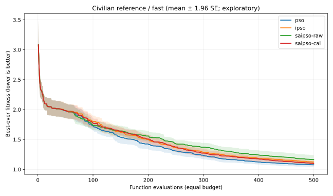
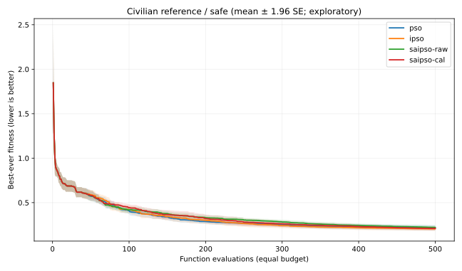
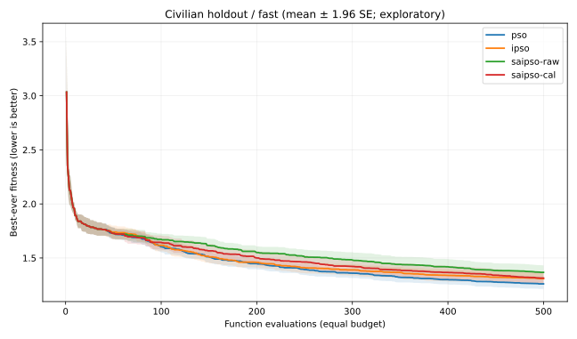
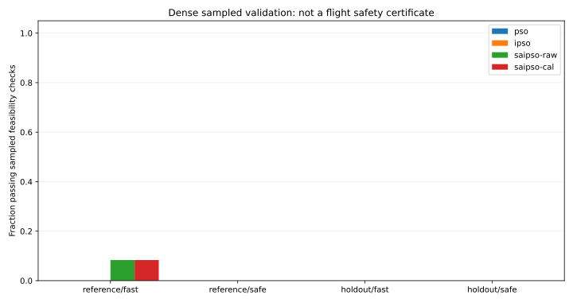

# v0.2.0 | 等评价预算下的 SA-IPSO 实验 / Equal-FE Study

## 研究问题

上一版使用相同迭代次数，而 SA-IPSO 的局部退火会消耗额外目标函数评价，导致与 PSO/IPSO 的比较并不公平。本版固定每次运行 **500 次函数评价（FE）**，所有评价都计入预算，包括种群初始化、粒子更新、免疫注入与局部模拟退火。四个对照组对每个任务共享相同初始随机种群。

- PSO：基础群体搜索。
- IPSO：PSO + 免疫记忆与概率选择。
- SA-IPSO (Raw)：按本文独立重建算法中的原始数值温度，加入退火接受和局部搜索。
- SA-IPSO (Calibrated)：按初始种群适应度标准差对退火温度进行尺度归一，属于**本项目新设对照**，并非论文原文。

实验采用预先列明的种子 100–111、论文中的两组任务外层权重、民用合成地形 reference 与另一组 **不参与调参** 的 holdout 地形。**总计 12 × 2 × 2 × 4 = 192 次运行**。

## 结果：mean ± std（越小越好）

| 地形 | 任务 | PSO | IPSO | SA-IPSO Raw | SA-IPSO Calibrated |
|---|---|---:|---:|---:|---:|
| 原始合成地形 | 快速 | 1.07727 ± 0.06679 | 1.12412 ± 0.08395 | 1.16364 ± 0.13360 | 1.10019 ± 0.06229 |
| 原始合成地形 | 安全优先 | 0.21715 ± 0.05377 | 0.20495 ± 0.04190 | 0.22130 ± 0.03841 | 0.21006 ± 0.03939 |
| 独立测试地形 | 快速 | 1.26071 ± 0.08268 | 1.30874 ± 0.09277 | 1.36704 ± 0.11554 | 1.31424 ± 0.09893 |
| 独立测试地形 | 安全优先 | 0.22291 ± 0.02170 | 0.21465 ± 0.01301 | 0.22776 ± 0.01587 | 0.21989 ± 0.01179 |

## 配对差异与探索性不确定区间

对每一对配对种子的最终最优值取差，随后通过 10,000 次**配对自助重采样**得到探索性 95% 百分位区间。差值为对应算法减 PSO，负数表示优于 PSO。**区间未经多重比较校正，不能解读为确证性统计发现。**

| 场景/任务 | 比较 | 平均差 | 探索性 95% 区间 |
|---|---|---:|---:|
| reference/fast | ipso-pso | +0.04685 | [+0.01256, +0.07733] |
| reference/fast | saipso-raw-pso | +0.08637 | [+0.03175, +0.15741] |
| reference/fast | saipso-cal-pso | +0.02292 | [-0.01821, +0.06404] |
| reference/safe | ipso-pso | -0.01220 | [-0.02828, +0.00165] |
| reference/safe | saipso-raw-pso | +0.00416 | [-0.01042, +0.02023] |
| reference/safe | saipso-cal-pso | -0.00708 | [-0.02529, +0.00680] |
| holdout/fast | ipso-pso | +0.04803 | [+0.00043, +0.09751] |
| holdout/fast | saipso-raw-pso | +0.10633 | [+0.05067, +0.15876] |
| holdout/fast | saipso-cal-pso | +0.05353 | [-0.00351, +0.10174] |
| holdout/safe | ipso-pso | -0.00826 | [-0.01963, +0.00138] |
| holdout/safe | saipso-raw-pso | +0.00485 | [-0.00808, +0.01786] |
| holdout/safe | saipso-cal-pso | -0.00301 | [-0.01412, +0.00770] |

## 可行性与技术判断

本实验采用加权软惩罚，而非保证硬约束满足的算法。对最终路线以每航段 101 个采样点进行独立检查，**192 条路线中仅有 2 条满足全部采样约束（都在 reference/fast，分别来自 Raw 和 Calibrated SA-IPSO）**，其余存在净空、爬升角、转弯角或限制空域违规中的至少一项。即使通过采样检查，也不等于连续路径的形式化安全证明。**所有路径仅可用于离线数值分析，不可直接执行实飞。**

本版本将独立场景的最小净空阈值改为 5.0（不改变原论文给出的起终点坐标），因为旧实验使用 10.0，而起终点附近的高斯地形高度为正，造成端点净空本身不足 10.0 的先天不可行问题。该更改是**独立民用基准的边界一致性修复，不代表作者原模型要求**。

**结论：** 原始高温退火配置在快速任务表现弱于 PSO；尺度校准减少了损失但尚未建立普适收益。IPSO 在安全优先任务具有更低的平均目标值趋势，但探索性区间多跨越零。最大的研究瓶颈是 **软惩罚的低适应度不代表硬约束的可行路径**。

## Evidence / 图表与数据









- 原始每次运行数据：[`equal_budget/metrics.csv`](equal_budget/metrics.csv)
- 参数、种子、场景、区间和统计：[`equal_budget/summary.json`](equal_budget/summary.json)
- 另外 4 张箱线图和完整 SVG 见 [`equal_budget/`](equal_budget/)

## 独立复现命令 / Reproduction

```bash
python -m pip install -e ".[test]"
python -m pytest -q
python -m saipso_uav.study --budget 500 --seeds 100 101 102 103 104 105 106 107 108 109 110 111 --output docs/equal_budget
```

## Recommended v0.3.0 tests / 下一阶段

1. 可行优先的约束处理（分层可行性规则或约束主导选择），明确零违规率与持续轨迹检验。
2. 更大的相同 FE 预算与分段报告；至少 30 个全新配对种子，严格冻结模型参数再开展检验。
3. 对模拟退火、免疫记忆和局部搜索分别消融，并报告运行时间、目标评估数以及完整的安全约束分项。
4. 预注册主指标与多重比较校正；添加真实高程数据前先检验地形输入与航迹动力学接口。

## English summary

This is a **civilian, independent implementation study**, not an exact reconstruction of the 2026 paper’s maps or original MATLAB software. All four arms were stopped at **500 fitness calls**, with **12 paired seeds × two synthetic terrains × two task weightings = 192 runs**. Raw-temperature SA-IPSO performed worse than PSO on the fast task. Temperature-scale calibration reduced the deficit but did not establish superiority. Only **2 of 192** returned routes passed all densely sampled checks; objective improvement must not be conflated with flight feasibility. Bootstrap intervals are exploratory, unadjusted for multiple comparisons, and not an operational safety claim.
