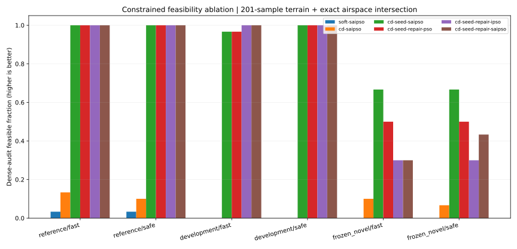
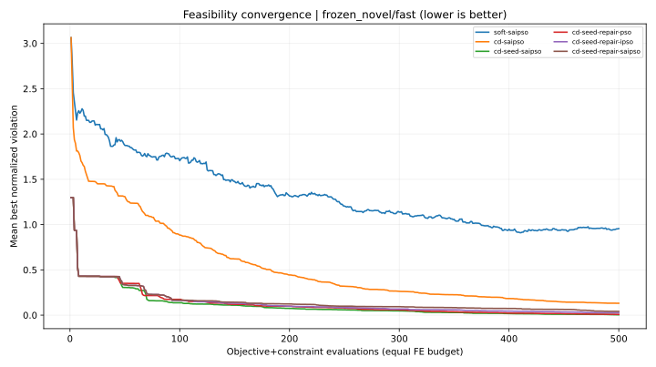
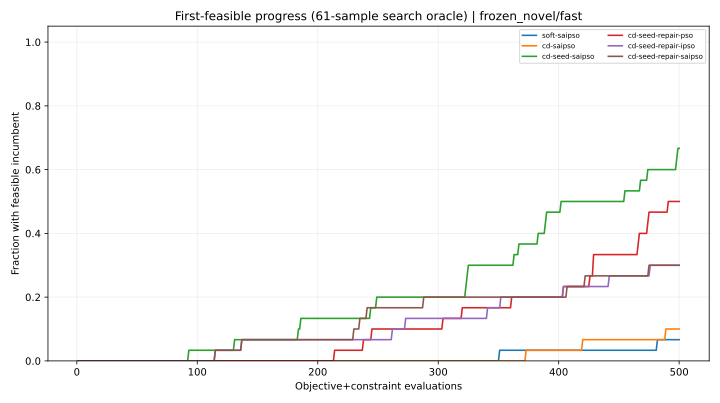

# v0.3.0 | 可行性优先的 SA-IPSO 扩展 / Feasibility-first Civilian Ablation

> Independent **civilian synthetic route-planning** extension to Fan Weilun (2026). Not the author's original MATLAB source, not original published numerical evidence, and not a flight-safety certificate.

## 研究目标 / Research question

v0.2.0 固定 FE 后发现传统软惩罚目标无法稳定输出满足飞行几何约束的路径。v0.3.0 测试两项不同假设：**可行性优先的 Deb 式约束支配选择**能否代替单纯软惩罚，以及**预设的民用绕行路径初始化**与几何修复能否增加最终可行解比例。进一步用免疫/退火消融核查额外搜索机制是否真正改善结果。

The primary endpoint is **the fraction of returned routes passing an independent feasibility audit**, *not* raw penalized fitness. Each arm consumes exactly 500 joint objective/constraint evaluation calls, while computational cost of each algorithm's internal operators is not otherwise equalized.

## 实验设置 / Protocol

- 6 methods × 2 weightings (fast, safe) × 3 civilian synthetic terrains × 30 new paired seeds (300–329) = **1,080 runs**, or **540,000 combined evaluations**.
- 20 particles, 10 interior waypoints; PSO coefficients and task outer weights are paper-derived, with all other feasibility-handling mechanisms original to this independent project.
- `reference` is the original synthetic terrain; `development` is v0.2's former holdout, which was inspected during subsequent development and is **not untouched**; `frozen_novel` is a new scenario frozen in source before the 30-seed experiment. All three are synthetic and hand-constructed; this is not evidence of generalization to real topography.
- In-search oracle samples terrain at 61 points per straight route segment and checks segment–circle horizontal intersections **exactly**. Independent final audit repeats terrain checks at 201 points per segment and uses the same exact geometric circle-intersection test. Even 201 samples do not provide a continuous collision-proof guarantee.
- All methods share the same random-initialization mechanism for their unseeded portion. Seeded variants overwrite up to eight of 20 initial particles with predefined northward detours; thus **these comparisons deliberately vary initialization** and are not a pure optimization-operator comparison.

### Consistent feature ablations

| Arm | Feasibility-first? | Explicit corridor seeds? | Convex repair operator? | Immune memory? | Annealing? |
|---|---|---|---|---|---|
| Soft SA-IPSO | No | No | No | Yes | Yes |
| CD SA-IPSO | Yes | No | No | Yes | Yes |
| CD + Seed + SA-IPSO | Yes | Yes | No | Yes | Yes |
| CD + Seed + Repair + PSO | Yes | Yes | Yes | No | No |
| CD + Seed + Repair + IPSO | Yes | Yes | Yes | Yes | No |
| CD + Seed + Repair + SA-IPSO | Yes | Yes | Yes | Yes | Yes |

The seeds are fixed analytic, domain-specific corridor templates rather than feasible paths discovered by SA-IPSO. The 'repair' operation deterministically blends a candidate with one template, and **is not a guaranteed projection to the feasible set**.

## 主结果：最终可行路径数量 / Primary outcome

Below are final outputs passing the *independent* dense audit; denominator for each scene/task is 30. A single output either passes *all seven* civilian checks or fails.

| 算法 / Method | reference fast | reference safe | development fast | development safe | novel fast | novel safe | Total / 180 |
|---|---:|---:|---:|---:|---:|---:|---:|
| Soft SA-IPSO | 1/30 | 1/30 | 0/30 | 0/30 | 0/30 | 0/30 | **2/180** |
| CD SA-IPSO | 4/30 | 3/30 | 0/30 | 0/30 | 3/30 | 2/30 | **12/180** |
| CD + Seed + SA-IPSO | 30/30 | 30/30 | 29/30 | 30/30 | 20/30 | 20/30 | **159/180** |
| CD + Seed + Repair + PSO | 30/30 | 30/30 | 29/30 | 30/30 | 15/30 | 15/30 | **149/180** |
| CD + Seed + Repair + IPSO | 30/30 | 30/30 | 30/30 | 30/30 | 9/30 | 9/30 | **138/180** |
| CD + Seed + Repair + SA-IPSO | 30/30 | 30/30 | 30/30 | 30/30 | 9/30 | 13/30 | **142/180** |

**Main finding:** Explicit geometrically-informed initialization is the dominant contributor here. Constraint domination alone improves the aggregate feasibility rate only modestly; the plain soft SA-IPSO reaches **2/180 (1.1%)**, whereas the CD+seed SA-IPSO arm achieves **159/180 (88.3%)**. However, the frozen novel scene has a substantially weaker rate (**20/30 per task**) than the original synthetic scenes. Adding the simple convex repair does not reliably help in that novel scene, and additional annealing is **not demonstrated to be superior** to PSO/IPSO.

**Critical design caveat:** An analytically predefined path makes some cases feasible **on initialization (at evaluation 1 or 4)**. These successes are not evidence that SA/IPSO autonomously discovered a feasible route, nor are the observed algorithm differences confirmatory causal findings.







## 次要结果：适应度 / Secondary outcome

Objective values are **not comparable across infeasible and feasible populations** as proof of optimization superiority. Means over all selected paths can deceptively favor soft methods that returned infeasible solutions. 'Audited feasible only' means are conditional on success, with different denominators, and should **not** be used as unconditional algorithm rankings.

|场景 / Scene|任务|Method|Mean objective (all)|Mean objective (audited feasible only)|
|---|---|---|---:|---:|
|reference|fast|Soft SA-IPSO|1.05501|0.88604|
|reference|fast|CD SA-IPSO|1.81842|1.38305|
|reference|fast|CD + Seed + SA-IPSO|0.81567|0.81567|
|reference|fast|CD + Seed + Repair + PSO|0.81680|0.81680|
|reference|fast|CD + Seed + Repair + IPSO|0.81849|0.81849|
|reference|fast|CD + Seed + Repair + SA-IPSO|0.82468|0.82468|
|reference|safe|Soft SA-IPSO|0.20688|0.14682|
|reference|safe|CD SA-IPSO|0.30020|0.22204|
|reference|safe|CD + Seed + SA-IPSO|0.13898|0.13898|
|reference|safe|CD + Seed + Repair + PSO|0.13988|0.13988|
|reference|safe|CD + Seed + Repair + IPSO|0.13888|0.13888|
|reference|safe|CD + Seed + Repair + SA-IPSO|0.14071|0.14071|
|development|fast|Soft SA-IPSO|1.28412|N/A|
|development|fast|CD SA-IPSO|1.67395|N/A|
|development|fast|CD + Seed + SA-IPSO|0.97177|0.97180|
|development|fast|CD + Seed + Repair + PSO|0.95521|0.95471|
|development|fast|CD + Seed + Repair + IPSO|0.95311|0.95311|
|development|fast|CD + Seed + Repair + SA-IPSO|0.95993|0.95993|
|development|safe|Soft SA-IPSO|0.21856|N/A|
|development|safe|CD SA-IPSO|0.29894|N/A|
|development|safe|CD + Seed + SA-IPSO|0.17220|0.17220|
|development|safe|CD + Seed + Repair + PSO|0.17020|0.17020|
|development|safe|CD + Seed + Repair + IPSO|0.16788|0.16788|
|development|safe|CD + Seed + Repair + SA-IPSO|0.17216|0.17216|
|frozen_novel|fast|Soft SA-IPSO|1.07348|N/A|
|frozen_novel|fast|CD SA-IPSO|1.52687|1.36118|
|frozen_novel|fast|CD + Seed + SA-IPSO|1.23610|1.21130|
|frozen_novel|fast|CD + Seed + Repair + PSO|1.23742|1.22587|
|frozen_novel|fast|CD + Seed + Repair + IPSO|1.23792|1.22266|
|frozen_novel|fast|CD + Seed + Repair + SA-IPSO|1.23664|1.22729|
|frozen_novel|safe|Soft SA-IPSO|0.18139|N/A|
|frozen_novel|safe|CD SA-IPSO|0.24738|0.22400|
|frozen_novel|safe|CD + Seed + SA-IPSO|0.27009|0.25375|
|frozen_novel|safe|CD + Seed + Repair + PSO|0.30095|0.29160|
|frozen_novel|safe|CD + Seed + Repair + IPSO|0.30007|0.26917|
|frozen_novel|safe|CD + Seed + Repair + SA-IPSO|0.30998|0.27587|

## 局限与下一步 / Limitations and next experiment

1. **Holdout integrity:** The v0.2 holdout was inspected while designing the corridor heuristics; v0.3 therefore labels it development. The newly frozen synthetic scene is different but not real-world validation. Evaluate additional *procedurally generated* terrains with independently fixed seeds and boundary-safe scenarios next.
2. **Initialization confounding:** Seeded methods start with eight analytically guided routes; report the best initial feasible objective and *improvement above this exact starting point* in the next version. Here the ablations show that the seed dominates the comparison.
3. **Constraint generalization:** The fixed template fails much more often on the frozen novel scene, and the convex repair degrades performance there. Next use adaptive, explicitly accounted geometry evaluation and path representation that can adjust detour topologies instead of relying on one privileged corridor.
4. **Audit limitation:** 201-sample terrain check is not a continuous collision proof. Check segment–terrain intersections with interval bounds or Lipschitz-safe envelopes; retain exact segment–disk checks. No dynamic obstacle, wind, vehicle acceleration envelope, local regulations, GPS error or real flight constraints were validated.
5. **Statistics:** 30 paired seeds describe variation under three fixed synthetic maps, **not** population-level geography. Paired bootstrap intervals in `summary.json` are exploratory, not multiplicity-corrected; do not claim statistical superiority based only on these.
6. **Software repeatability:** Python + NumPy + Matplotlib + pytest, with raw CSV, summary JSON, full generated SVG evidence, recorded seeds, scenarios, constraint sampling density and machine-specific runtime version information.

## Reproduction / 运行方法

```bash
python -m pip install -e ".[test]"
python -m pytest -q
python -m saipso_uav.study_v03 --budget 500 --seeds $(seq 300 329) --output docs/feasibility_v03
```

Machine-readable evidence: [`metrics.csv`](feasibility_v03/metrics.csv) and [`summary.json`](feasibility_v03/summary.json). Complete vector figures including all six scene-task combinations are in [`feasibility_v03/`](feasibility_v03/). No result is supplied as a real-flight recommendation.
