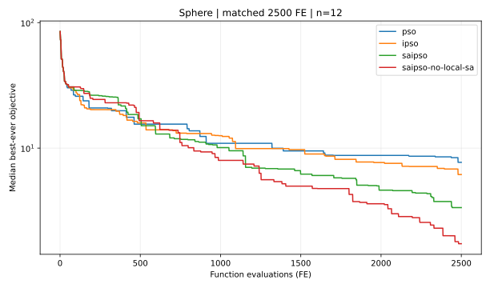
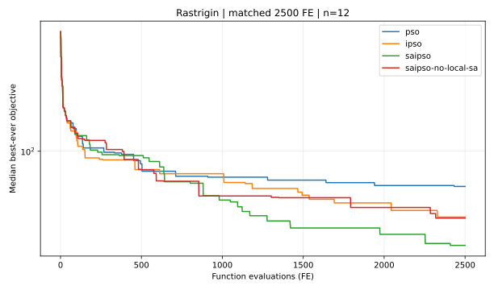
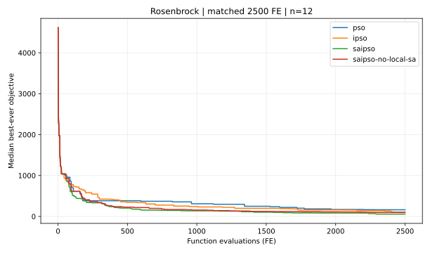

# v0.4.0 — SA-IPSO 论文算法机制复现核查与独立对照实验

参考：范伟伦，《基于 SA-IPSO 融合算法的无人机航路规划》，《舰船电子工程》，2026 (6)，DOI 10.3969/j.issn.1672-9730.2026.06.009。

## 本轮修正

v0.3.0 以民用航路可行率为重点，其中免疫筛选使用**按排名采样**，并不等价于原文第 2.4 节的联合免疫概率。因此本轮新增 `paper_core.py`，与已有工程实现独立，专门验证论文明确写出的算法机制。

### 逐项论文对照

| 论文位置 | 原文可验证内容 | 本项目新实现 | 状态 |
|---|---|---|---|
| §2.1 | 模拟退火概率接受较差个体极值 | `metropolis()` + `pbest_sa` 开关 | 核心原则实现；温度更新到 pbest 过程为复现假设 |
| §2.2 | $\omega_t=\omega_\max-(\omega_\max-\omega_\min)t/t_\max$ | `inertia()` 和公式测试 | 公式直接复现 |
| §2.3 | 代际历史全局最优作为免疫记忆 | 精英去重、有限容量档案 | 设计原则实现，替换细节属假设 |
| §2.4 | 亲和力倒数 + 适应度差异的倒浓度，$\beta=0.5$ | `probability()`，显式处理零差异 | 公式直接复现，数值边界保护为新增 |
| §2.5 | 连续 2 次改进小于 $10^{-4}$，触发 SA，发现更优个体替换粒子 | stagnation counter + SA refinement + population injection | 触发条件复现；邻域搜索与扰动幅度属假设 |
| §4 | $M=20,N=10,n=10,c_1=c_2=2.05,\omega_\max=0.9,\omega_\min=0.4,v_\max=20,T_0=2000,T_\mathrm{end}=10,\alpha=0.8,t_\max=1000$ | `CoreConfig()` | 数值参数已复现 |

第 4 节中的 `n=10` 原文对应**航路点维数/数量**，在本独立数学函数实验中将其设为 10 维决策向量只是一种数值基准维度选择，不能等同于原文 3D 航路点的编码。

## 研究协议与结果

- 2,500 FE/次，配对随机种子 700–711（12 个）；3 个标准数学函数 × 6 个算法/消融组，共 **216 次**；每次完整记录 2,500 个历史最优值。
- 另以完全相同的论文数值参数，对 Sphere/Rastrigin/Rosenbrock × PSO/IPSO/SA-IPSO 各执行一次 **1000 次迭代**，共 **9 次**。这些算法消耗的 FE 不同，**不能用作等 FE 的优越性比较**。
- 六组分别是 PSO、IPSO、SA-IPSO、无免疫、无 pbest 退火接受、无局部 SA。

等 2,500 FE 的平均最终目标值（越低越好）：

| Function | PSO | IPSO | SA-IPSO | SA-IPSO without local SA |
|---|---:|---:|---:|---:|
| sphere | 7.2004 | 5.8372 | 3.6030 | 2.1915 |
| rastrigin | 82.0925 | 73.7775 | 64.9747 | 72.9810 |
| rosenbrock | 182.9719 | 126.8807 | 71.1774 | 102.1852 |

由于函数尺度差异较大，禁止跨函数直接平均目标值。仅比较同一函数、同一 FE 预算、相同配对种子的结果。

**机制分析**：SA-IPSO 的 12 种子均值在 Rastrigin 与 Rosenbrock 上低于 PSO/IPSO；Sphere 上删除局部 SA 的变体均值反而更低。当前不能证明 SA 局部搜索在所有问题上都有效，单一场景结果也不能外推至无人机航路规划。

按原论文 1000 迭代次数，单次实验的实际 FE 数量：

| 函数 | PSO | IPSO | SA-IPSO |
|---|---:|---:|---:|
| Sphere | 20020 | 22020 | 44148 |
| Rastrigin | 20020 | 22020 | 42516 |
| Rosenbrock | 20020 | 22020 | 32724 |

因此，旧版把迭代数相同当成计算预算相同是不合理的。本轮脚本针对每个分支严格记录评价次数。







[机器可读数据](paper_core_v04/metrics.csv) / [均值、配对差与不确定性区间](paper_core_v04/summary.json)

## 未被原文公开、因此不能称为原作者复现的部分

1. 免疫存储粒子的交换和替换细节、SA 局部邻域生成与随机初始化均没有足够精确信息；目前全部已作为实现假设标注。
2. 原始 Matlab 源码、随机种子、地图几何与路径惩罚参数未提供；未复刻原图 3–8 的数值。
3. 原论文的军事威胁规避模型没有在本项目实现；这里只实现一般连续优化和民用合成环境。
4. 12 个种子的 bootstrap 区间用于探索；未进行多重检验修正，不能声称统计显著或算法通用最优。

## 复现实验

```bash
python -m pip install -e ".[test]"
python -m pytest -q
python -m saipso_uav.paper_study --budget 2500 --seeds 700 701 702 703 704 705 706 707 708 709 710 711 --output docs/paper_core_v04
```

## 下一步

下一阶段不优先叠加新算子，而是对已公开的公式进行更严格的机制对照、参数敏感性试验，并将**全三维航路点表示**集成到民用路径模型中。需要用多随机种子、大样本验证 SA 接受温度与免疫浓度公式是否提供独立增益。

---

**English:** This release isolates the paper-stated SA-IPSO mechanisms and verifies them on nonmilitary numerical functions. 216 paired, 2,500-FE trials and 9 fixed-1000-iteration runs are included, with all raw values and vector plots. Methods for elite replacement and annealing neighborhoods are openly documented assumptions; no author MATLAB artifacts, military defense-evasion models, or exact figure replication are claimed.
