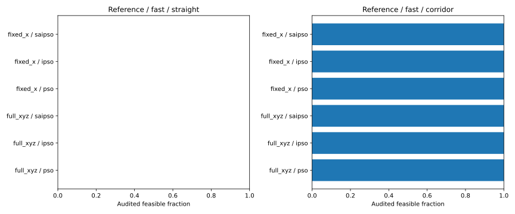
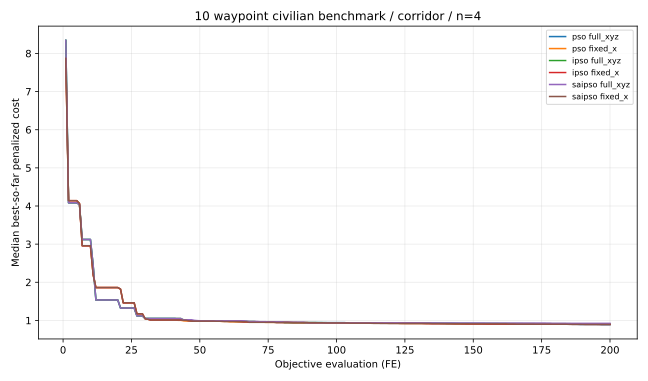
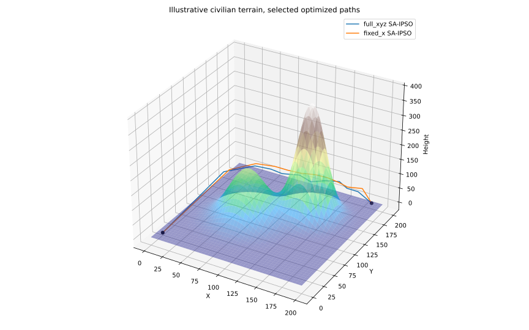

# v0.5.0 — 三维航路编码与五项性能约束的核查

**参考文献**：范伟伦，《基于 SA-IPSO 融合算法的无人机航路规划》，《舰船电子工程》，2026 (6)，DOI: 10.3969/j.issn.1672-9730.2026.06.009。

## 本轮真正修正了什么

原论文第 4 节将中间航路点写作 $(x_{ij},y_{ij},z_{ij})$ 的三维坐标。v0.1–v0.4 的民用航路实验实际上固定了每个中间航路点的 x，仅允许 y/z 变化。本版新增 `route3d.py`：10 个中间点，每点三个连续控制量，**共 30 个决策控制量**，且其 x 坐标随控制量变化。注意，原文并未公开坐标初始化和搜索边界；本实现的 x 自由度限在固定间距的 ±32% 内，属于公开声明的复现假设。

分别检验论文 §3.1 中五项性能约束：**最小航段长度**、**最大转弯角**、**最大航程**、**最大爬升/俯冲角**、**最低飞行高度**。此外，民用场景独立检查离地净空、限制空域和飞行高度上限。前五项与原文建模类别对应；额外三项与原文并不完全相同。圆形限制空域采用精确线段-圆盘最近距离；地形净空为每段 201 点采样，**不是连续几何证明**。

新方法保持论文核心 `paper_core.py` 的 SA-IPSO 优化器，不增添未经证实的优化算子。比较 `full_xyz` 与 `fixed_x`；两组都保留 30 个控制量，后者将 x 控制量设为无效变量以保证相同的随机初始序列。因而**固定 x 组有 10 个无效维度**，本对照仅提供探索性证据，不能当作严格的不同维数算法效率排序。

## 实验方案及结果

- 地形：`reference` 与先前在 v0.3 使用过的 `frozen_novel`；两者都**不是未见过的盲测地图**。
- 权重：论文给出的快速任务与安全优先任务外层三项权重；内层代价为自行构建的**民用**地形/空域代价，与原文雷达、防空武器模型无关。
- 初始化：`straight` 直线基准和 `corridor` 人工绕行基准；区分了初始化贡献与算法贡献。
- 方法：PSO、IPSO、SA-IPSO。每组 4 个配对种子（800–803）、200 次**严格计数**的联合目标评价。**192 次运行、38,400 次函数评价**。
- 每次结束之后，用每航段 201 个采样点、精确圆形限制区相交检测，独立评估约束。

| 分类 | 通过独立约束检查 | 运行次数 |
|---|---:|---:|
| 所有实验 | **48** | 192 |
| 直线初始化 | **0** | 96 |
| 绕行初始化 | **48** | 96 |
| 基准地形 | **48** | 96 |
| 已用过的另一地形 | **0** | 96 |
| 完整 XYZ | **24** | 96 |
| 固定 X | **24** | 96 |
| PSO | **16** | 64 |
| IPSO | **16** | 64 |
| SA-IPSO | **16** | 64 |

**主要结论**：开放 x 坐标完成了表示能力的修正，但在该小样本、短评价预算中**没有改善路径可行率**；三种算法的可行率完全一样。有效路径高度集中于单一地图和人工绕行模板，因此把收益归因于 SA/IPSO 算子不成立。仅比较完整路径的可行率，不能推断其在真实无人机上的可执行性。

基准地形、快速权重、绕行初始化的平均目标值（越低越好，n=4）：

| 算法 | 完整 XYZ | 固定 X |
|---|---:|---:|
| PSO | 0.89293 | 0.89782 |
| IPSO | 0.90499 | 0.89864 |
| SA-IPSO | 0.92468 | 0.89805 |

在这一条件下 SA-IPSO 完整 XYZ 并不优于两个基线，且总体最优差距很小、样本量太少。不得将“成本下降”解释为可靠的算法显著性。

## 图表与数据







- [逐次实验 CSV](route3d_v05/metrics.csv)
- [完整配置与机器可读汇总 JSON](route3d_v05/summary.json)

## 可复现命令

```bash
python -m pip install -e ".[test]"
python -m pytest -q
python -m saipso_uav.route3d_study --budget 200 --seeds 800 801 802 803 --output docs/route3d_v05
```

## 后续方向

在继续尝试任何新算子前，先提高独立场景的可行率，并进行更公平的初始路径消融。随后增加独立随机种子与目标评价预算，冻结新场景生成协议。此阶段**不声称已获得原文 MATLAB 地图、军事威胁模型、图 3–8 数值复刻或实飞可靠性**。

---

**English summary.** This release corrects the earlier fixed-x route representation by introducing 30 controls for ten 3-D intermediate waypoints, and audits the article's five flight constraint categories in a separate civilian terrain benchmark. In a 192-run paired pilot (four seeds, 200 FE each), 48 candidates passed the dense independent audit. All were produced with the predeclared detour baseline on one previously inspected scene. Full XYZ did not increase feasibility; PSO, IPSO and SA-IPSO had identical counts. The civilian benchmark is not the author's MATLAB scenario, and no actual flight safety or military evasion is claimed.
